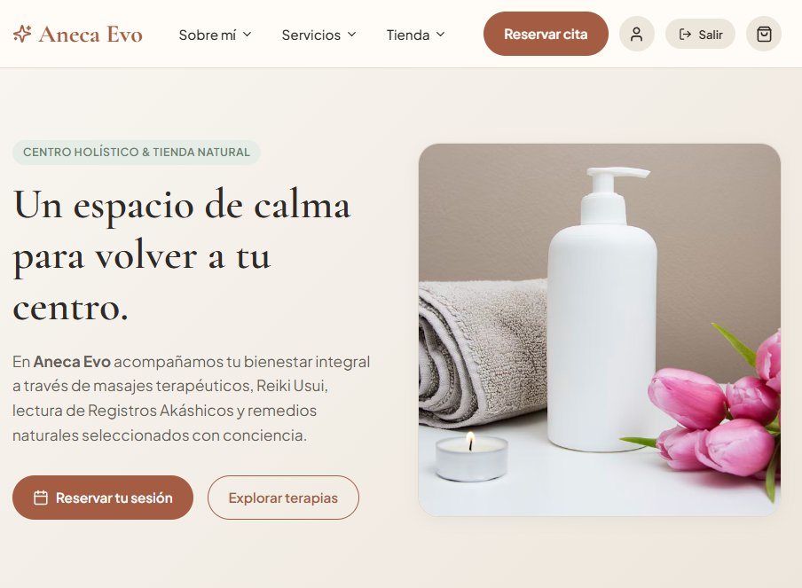
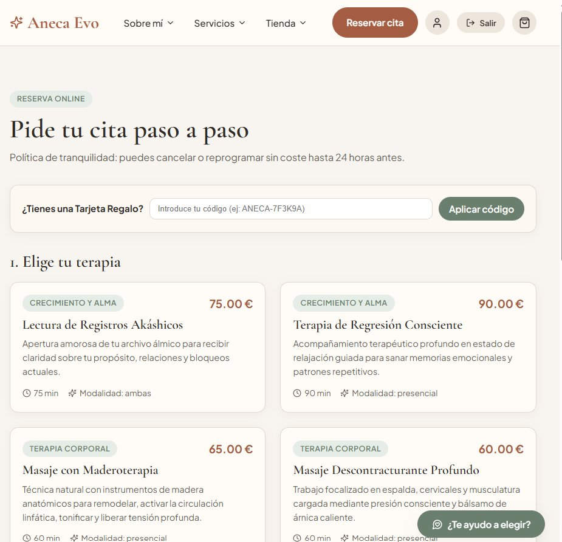
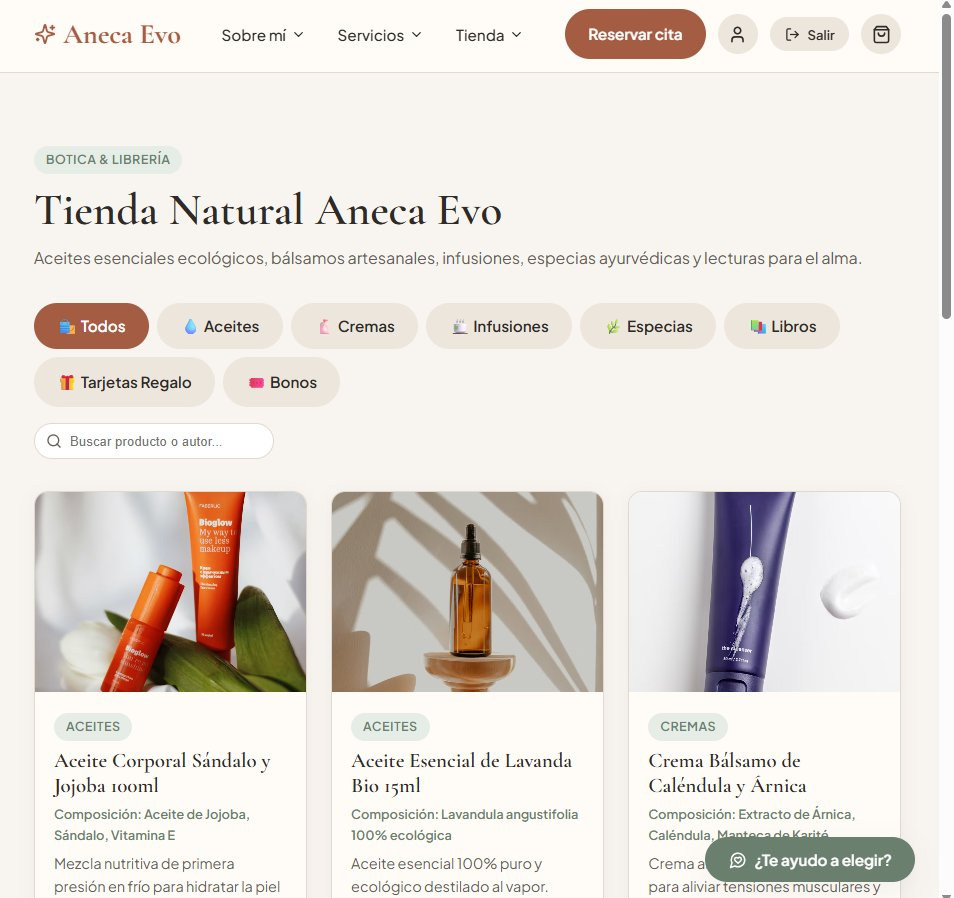
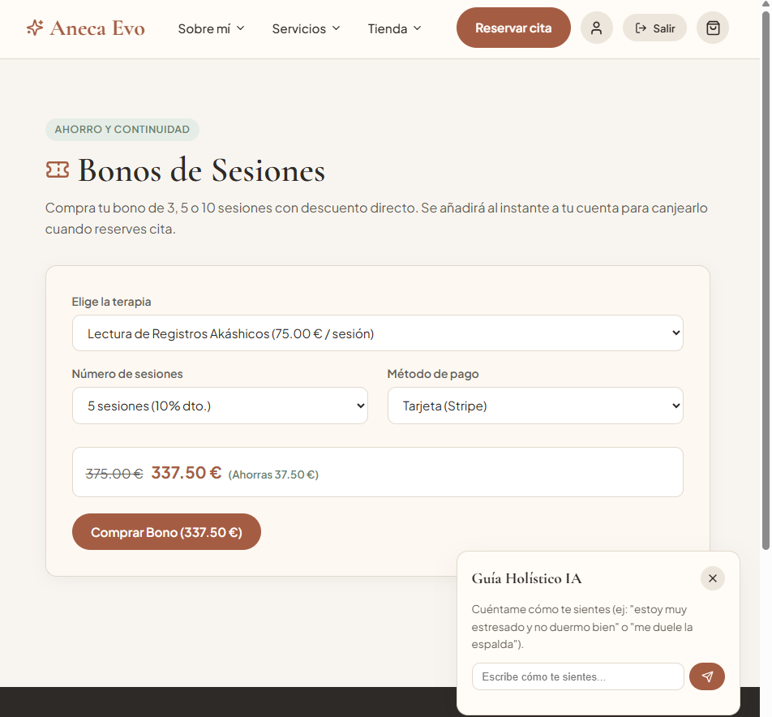

# 🌿 Aneca Evo — Centro Holístico & Tienda Natural

**Aneca Evo** es una aplicación web integral diseñada para la gestión de un centro de terapias holísticas y su tienda natural online. Permite a los clientes explorar terapias, reservar citas paso a paso con control real de agenda, adquirir bonos de sesiones, regalar tarjetas personalizadas descargables en PDF y comprar productos naturales, mientras ofrece un panel privado de administración para gestionar agenda, clientes, inventario y pedidos.

---

## ✨ Qué hace la aplicación

### 1. Portada y Navegación Serena
Diseño en tonos tierra y calma (`#F8F5F0`, `#A45D43`, `#6B7F6E`) con menús desplegables organizados por afinidad (*Sobre mí*, *Servicios* y *Tienda*), acceso directo a **Reservar cita**, área de usuario y carrito lateral desplegable.



### 2. Reserva de Citas Paso a Paso
- **Catálogo de terapias**: Terapias Corporales (*Masaje Relajante*, *Descontracturante*, *Maderoterapia*), Terapias Energéticas (*Reiki Usui*, *Cuencos Tibetanos*) y Crecimiento y Alma (*Registros Akáshicos*, *Regresiones*).
- **Calendario inteligente**: Calcula los huecos libres reales respetando horarios de apertura, festivos o cierres por horas, el **margen de descanso (buffer)** entre sesiones y ocultando horas pasadas del día actual.
- **Canjeo de Tarjetas Regalo y Bonos**: Permite aplicar códigos de tarjeta regalo (ocultando precios al destinatario) o canjear sesiones de bonos activos.
- **Cuestionario previo (Anamnesis)**: Recoge alergias, embarazo, lesiones o intención de la sesión antes de confirmar.



### 3. Tienda Natural y Cesta
- **Filtros por categoría y buscador**: Aceites, Cremas, Infusiones, Especias y Libros recomendados, con venta cruzada de productos afines en cada terapia.
- **Carrito lateral**: Descuento automático de stock mediante transacciones en base de datos, formulario completo de envío y comentario opcional.
- **Gestión post-compra**: El cliente puede modificar datos de envío o cancelar su pedido (con motivos) durante las primeras 12 horas, con cuenta atrás en vivo.



### 4. Bonos de Sesiones, Tarjetas Regalo PDF y Guía IA
- **Bonos de Sesiones**: Packs de 3, 5 o 10 sesiones con descuento automático vinculados a la cuenta del cliente para reservar directamente.
- **Tarjetas Regalo**: Compra online o emisión presencial con dedicatoria personalizada, código único de canje y **descarga directa en PDF** sin precio visible.
- **Asistente Holístico IA**: Widget flotante que recomienda terapias y productos del catálogo real según cómo se sienta el visitante.



### 5. Panel Privado de Administración
- **Notificaciones en cabecera**: Campana de alertas clicables para pedidos pendientes, cambios de dirección o próximas citas.
- **Agenda y Festivos**: Calendario mensual con ventana emergente por día, estados de cita (*Realizada*, *Cancelada por cliente*, *Cancelada por admin* con motivo y aviso directo por WhatsApp/Email), detalle de pagos y bloqueo de festivos por fechas y horas.
- **Clientes y Fichas Privadas**: Buscador por nombre o teléfono, antigüedad del cliente, reserva presencial con calendario, notas privadas de evolución, bonos y tarjetas regalo.
- **Inventario y Servicios**: Alta, edición, eliminación, subida de fotos y actualización masiva de precios (`%` o `€`) por categoría.
- **Pedidos**: Confirmación de pedidos, seguimiento de estado y comunicación directa con el cliente.

---

## 🗂️ Estructura del Proyecto

```text
AnecaEvo/
├── frontend/                   # Aplicación React + Vite
│   ├── components/             # Navbar, Footer, CalendarioCitas, TarjetaProducto, CarritoLateral, Asistente
│   ├── context/                # Estado global de autenticación y carrito
│   ├── pages/                  # Inicio, Sobre mí, Servicios, Reservar, Tienda, Bonos, Tarjetas Regalo, Mi Cuenta y Admin
│   ├── services/               # Cliente HTTP (api.js) y generador de Tarjeta Regalo PDF
│   └── styles/                 # Paleta tierra/calma y diseño responsive
│
├── backend/                    # API REST en Node.js + Express
│   ├── config/                 # Conexión a PostgreSQL / Supabase (db.js)
│   ├── controllers/            # Lógica de negocio (auth, citas, servicios, productos, pedidos, clientes, tarjetas, asistente)
│   ├── middlewares/            # Verificación JWT y control de rol administrador
│   ├── routes/                 # Rutas modulares (/api/...)
│   ├── services/               # Envío de emails (Nodemailer) y pasarela de pago
│   ├── server.js               # Servidor Express con Helmet, CORS y Rate Limiting
│   └── initDb.js               # Script de inicialización de tablas y datos semilla
│
└── datos/                      # Esquemas SQL de la base de datos
    ├── aneca_evo.sql           # Esquema original MySQL
    └── aneca_evo_postgres.sql  # Esquema adaptado a PostgreSQL / Supabase
```

---

## 🛠️ Tecnologías Utilizadas
- **Frontend**: React 18, React Router, Vite, Lucide Icons, CSS3 Responsive.
- **Backend**: Node.js, Express, JWT, bcryptjs, Helmet, express-rate-limit, Nodemailer.
- **Base de Datos**: PostgreSQL (Supabase) / MySQL.
- **Despliegue**: Render (Backend Web Service + Frontend Static Site) y Supabase.
